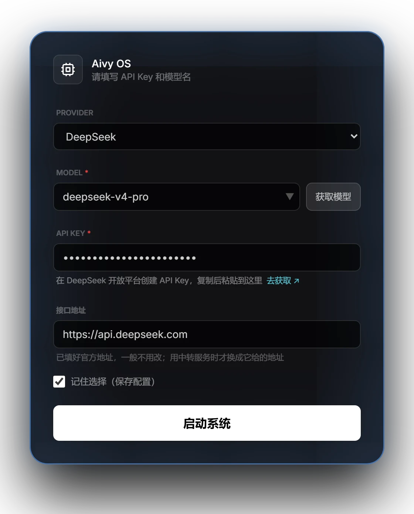

# Aivy OS 入门指南

> 从安装到第一次对话，大约十分钟。每一步都和软件里看到的一样。

---

## 📋 她能做什么（完整能力一览）

在配置之前，先看看她能做什么——确认这是你想要的：

| 分类 | 能力清单 |
|------|----------|
| **🤖 智能体核心** | 流式打断不丢工具 · 子智能体后台并行 · 自唤醒（定时/条件触发）· Mission 长任务追踪 · 任务看板（跨对话持久化项目记录）· 实时进度展示 · 反幻觉机制 |
| **🧠 记忆系统** | 三层架构（核心永久/长期向量/短期窗口）· 用户画像（dict 原子操作 + 加密）· **Wiki 知识库**（项目/主题/分析/sources 双向引用 + 自动归纳）· 跨会话向量检索（5000+ 条精准命中）· 元 Skill 自动归纳 · 离线归档 + 上线主动汇报 · 异常关闭自动补录 |
| **🛠 系统工具** | 文件读写 + Diff Review · 大文件分页读取 · 私人项目工作区 · 全盘搜索（内置 ripgrep + fd）· 命令行（CMD/PowerShell，耗时命令后台跑、跑完主动通知）· Python 持久环境 · 系统监控 · 软件管理（winget） |
| **🖥️ 电脑操作** | 直接操作窗口与控件 · 打开已安装的应用 · 右键菜单/下拉菜单/对话框 · 被遮挡窗口补截 · 等软件忙完再继续 · 做完读回核对 |
| **🌐 网络工具** | 浏览器自动化（Playwright · 多标签 · iframe · 网页弹窗）· 联网搜索（优先用模型自带的联网搜索，浏览器兜底）· Webhook 事件接收 |
| **🎙️ 语音** | 全双工对话 · 轻柔打断 · 咳嗽/清嗓不打断 · 本机先判断再识别 · 听得出语气 · 朗读音色随心情变换语气 · 允许主动开口 |
| **🪟 预览台** | 文档/表格/PDF/网页/代码在旁边同屏打开，她改了什么你同步看见 |
| **👁 视觉理解** | 截图/录屏 · 图片/PDF/表格 视觉解析（多模态模型自动启用） |
| **📄 文档工具** | PDF/Word/Excel/PPT 读写编辑（无需装 Office）· 文档批处理 |
| **🎨 IDE 模式** | 三栏视图（文件树 + Monaco + 对话）· Diff Review 逐块审核 · 撤销时间线（200 条 / 48 小时） |
| **📞 多通道** | 网页 / 微信 / 邮件 / 桌面悬浮窗——同一个她跨通道统一 |
| **🔒 安全保护** | 主人密钥认证 · 启动自动锁屏 · 她感知到你离开自动归档切离线 · 灵魂数据机器绑定加密 · 陌生人识别保持距离 |
| **🤝 协议兼容** | OpenAI / Anthropic / Google / Ollama 多厂商 · Function Calling 统一规范 · **MCP 协议**（v1.7.3 集成完整管理面板，连接任意 MCP Server） |
| **🎭 人格 + 扩展** | AI 人格系统（性格/记忆/关系/称呼/说话风格，可自定义）· Skill 系统（教她新技能）· 元 Skill 机制 |

### 💎 **Wiki 知识库**——她真正的"长期大脑"

Aivy OS 内置完整的 Wiki 知识编译层（受 Karpathy LLM Wiki 启发）：

- **项目页** `projects/*.md`：跟踪你的每个长期项目（创业、训练、研究等）
- **主题页** `topics/*.md`：领域知识沉淀（技术笔记、决策、经验教训）
- **实体页** `entities/*.md`：人物画像（同事/朋友/家人各自独立）
- **分析页** `analysis/*.md`：好答案回存，下次复用
- **sources 页**：原始对话来源追溯
- **双向交叉引用**：所有页面互相链接
- **自动 Ingest 归纳**：从对话自动归纳出 Wiki 页面（不需要你手动整理）
- **置信度追踪**：每条信息标记 high/medium/low confidence
- **版本取代**（supersedes）：旧观点被推翻时自动标记
- **Lint 健康检查**：自动检测过期/孤立/矛盾页面

**意思**：你和她聊得越多，她的"知识库"越丰富——下次问她"我们之前是怎么决定 XX 的"，她精准翻出当时的讨论。

---

## 1. 安装

- **系统**：Windows 10 或 Windows 11（64 位）。Windows 7 / 8 无法安装，安装程序一打开就会提示；暂不支持 macOS / Linux
- **磁盘**：安装包约 1 GB，安装后约 3 GB
- **网络**：使用云端模型时需要联网；用 Ollama 本地模型可以离线

1. 去 [Releases 页面](https://github.com/Bo1202/Aivy-OS/releases/latest) 下载 `Aivy OS Setup 2.6.0.exe`（页面上显示为 `Aivy.OS.Setup.2.6.0.exe`），双击运行，按提示安装。安装时有进度条，一般一两分钟。
   如果 Windows 提示「已保护你的电脑」，点「更多信息」→「仍要运行」——这是 Windows 对没有购买微软签名证书的软件的统一提示。
2. 第一次打开会慢一些：系统正在检查新程序的文件（杀毒软件扫描）。等待页上会显示「已等」多久，好了会自动进入，**不要重复打开**。

> 如果 Windows 防火墙弹出「已经阻止此应用的部分功能（aivyos.exe）」，点「取消」即可。在本机使用不受影响。

---

## 2. 第一次打开

1. **软件许可协议**　如果出现，阅读后勾选同意，按页面提示继续。
2. **创建你的 AI 伴侣**　填三样：AI 的名字、她怎么称呼你、认证密码（输两次）。认证密码以后用来确认「是你」，请记住它，别告诉别人。
3. **语义搜索配置**　语义模型已经随安装包内置，通常不用改，直接点「完成设置」。
4. **基因组（灵魂）**　会弹出一个编辑器，里面是她的性格和说话方式，已经有默认内容。不想改就直接点「保存并重启」，确认框里再点一次「保存并重启」，倒数 3 秒后程序会自动重启一次。
5. **选模型、填 Key**　重启后出现启动配置：
   - 在 Provider 里选一家模型服务（还没有 Key？见下一节）；
   - 把 API Key 粘进去——输入框下面写着去哪里获取，点「去获取 ↗」直接打开那个页面；
   - 点模型框右边的「获取模型」，能用的模型都列出来，点一个就填好，也可以手动输入；
   - 接口地址已按厂商填好，一般不用改；用中转服务时才换成它给的地址；
   - 保持「记住选择」勾选，点「启动系统」。
6. **认出你**　进入主界面后，在输入框里输入认证密码并发送（输入框里提示的「唤醒密码」就是它）。她认出你，就可以开始了。**每次重新打开软件，都要再发一次**——没认证时她只把你当访客：能聊天、上网查、看你发来的文件，动你电脑和数据的事都不做。

---

## 3. 申请模型 Key

任选一家即可，之后随时可以再加。国内用户推荐 **DeepSeek** 或**通义千问**：直连、注册简单、价格低。

| 启动配置里选 | 去哪里创建 Key | 说明 |
|---|---|---|
| DeepSeek | [DeepSeek 开放平台 · API Keys](https://platform.deepseek.com/api_keys) | 充值后即可使用 |
| 阿里通义千问（百炼） | [阿里云百炼控制台](https://bailian.console.aliyun.com/) → API-KEY（密钥管理） | 语音也可以用同一个 Key（语音地域选北京时） |
| Moonshot Kimi | [Kimi 开放平台 · API Keys](https://platform.moonshot.cn/console/api-keys) | |
| 智谱 GLM | [智谱开放平台 · API Keys](https://bigmodel.cn/usercenter/proj-mgmt/apikeys) | |
| OpenAI | [OpenAI 平台 · API keys](https://platform.openai.com/api-keys) | 需要海外网络和海外支付方式 |
| Google Gemini | [Google AI Studio](https://aistudio.google.com/apikey) | 需要海外网络和海外支付方式 |
| Anthropic Claude | [Anthropic 控制台 · API Keys](https://console.anthropic.com/settings/keys) | 需要海外网络和海外支付方式 |
| Ollama（本地） | 不需要 Key：装好 [Ollama](https://ollama.com)，用 `ollama pull` 下载一个模型 | 完全在本机运行；速度取决于你的电脑 |
| 通用 API（OpenAI 兼容） | 你所用服务商的后台 | 接口地址填服务商给的，通常以 `/v1` 结尾 |

> 三件事：Key 创建后往往**只完整显示一次**，当场复制存好；Key 等于你的账户余额，**别发给任何人**；提示余额不足（quota）就是该去对应平台充值了。

---

## 4. 开启语音

以阿里云百炼为例：地址、模型和默认音色都已经预填好，你只需要一个密钥。

1. 先完成第 2 节最后一步的认证——没认证时，语音页只会显示「需要先认证」。
2. 在 [阿里云百炼控制台](https://bailian.console.aliyun.com/) 的「API-KEY」页面创建并复制密钥。密钥要和地域一致：北京和新加坡的密钥不通用。模型也用通义千问的话，可以用同一个 Key（地域选北京）。
3. 点主界面右上角的「设置」，切到「语音」页。「语音服务」里已经选好「阿里云百炼」，「地域」是「北京」。
4. 把密钥粘进「密钥（API Key）」，点「验证并保存」（按回车也行）。它会真的连一次服务、念一句再听一遍，大约 15 秒，**通过了才会保存**。
5. 第一次通过后，状态卡里会问「开启前确认一下：只有你在用吗？」。点「确认，只有我」，语音对话就开了，以后不再问；点「先不开」就先不开。
6. 状态卡写着「可以开始了」，就说明整条线路都通了（卡片变绿、四行都打勾；实时对话没通过时会自动改成标准模式，卡片是黄色，也能用）。想换音色，在「选择音色」里点一张卡片，就会换上并念一句。
7. 点「开始语音对话」，或者发送键左边的声波按钮，开口说话。她说话时你随时可以插话；点右上角的 × 或按 Esc 结束。

> 想让她的提醒、后台任务完成的消息也念出来，打开「允许主动开口」（默认关闭；微信消息不会被念出来）。用其他语音服务时，在「语音服务」里点「其他服务」（要支持 OpenAI 兼容的识别和合成接口），填「服务地址」、模型和密钥，点「连接并检查」，通过了才会换上。

> 改了地域或模型后检查不通过：点「恢复默认」（状态卡上，或「高级设置」里「模型」旁边）。地域回到北京、业务空间清空、模型回到推荐值，密钥不动（音色用不了时会换成推荐音色），改完会自动再检查一次。

---

## 5. 试试跟她说这些

> 刚醒来不知道跟她聊什么？照下面说就行——每句都是一次完整的能力展示。

### 🎯 必试的 6 句

| 你说 | 她会 | 展示的能力 |
|---|---|---|
| "你好，介绍一下你自己" | 以她的人格回应你 | 数字人格 |
| "帮我看看我这台电脑卡不卡" | 拉 CPU/内存/磁盘数据给你体检 | 系统工具 |
| "记住：我喜欢喝美式咖啡，不加糖" | 写进长期记忆 | 记忆系统 |
| "明天早上 9 点提醒我带钥匙" | 到点主动提醒你 | 自唤醒 |
| "帮我查一下明天北京的天气" | 上网搜索给你结果 | 网络工具 |
| "我心情不太好，陪我聊会儿" | 以她的人格陪你 | 情感陪伴 |

### 💡 进阶玩法（用熟了再试）

- **"帮我把这个 PDF 转成 Word"**——拖个文件进去，她读、转换、交付
- **"把这个 Excel 分析一下，画个图"**——数据分析 + 可视化一条龙
- **"帮我在京东搜一下 XX 的价格"**——她自己开浏览器操作
- **"我需要一个能 XX 的功能"**——她去插件市场装新技能
- **"把这个项目整理到 Wiki 里"**——她自动归档成知识库

**记住：你不用学怎么用她，直接说人话就行。她听得懂。**

---

## 6. 日常使用

- **换模型**：输入框旁的模型按钮（鼠标停上去显示「切换模型」）随时切换，不用重启。正在回答的这一轮用原来的模型做完，下一句就用新的。要加新模型，在菜单最下面点「配新模型 → 设置」
- **打断她**：回答或执行时，发送键会变成停止键，点一下就停；语音里直接开口就行
- **预览台**：她做好的表格、文档、PDF、网页、代码会在右侧打开，不用切窗口
- **撤回改动**：右上角「改动」里按时间列着她改过的代码和配置文件，不满意可以撤回。认证后才会出现
- **代码工作区**：右上角「IDE Workspace」进入：文件树、编辑器、对话在同一个窗口
- **交代长期的事**：直接说「每天早上八点提醒我……」「这件事帮我盯着」，她会到点自己醒来去做
- **后台在做什么**：交给后台的事在跑时，输入框上方会出现「后台 1」这样的小标识。鼠标停上去能看到每项在做什么，点一下可以钉住
- **对话很长时**：输入框旁的小圆环是这段对话占了多少。到圆环上那条刻度线时，较早的对话会自动整理，原文都留着；点圆环可以调「整理线」

---

## 7. 数据与卸载

- **数据在哪**：对话、记忆、设置都在本机的 `%LOCALAPPDATA%\AivyOS\`；语音密钥单独加密保存在 `%USERPROFILE%\.aivyos`。想换电脑，备份数据目录即可。
- **谁能访问**：默认只信任本机：来自局域网和其他设备的连接一律拒绝。要远程使用，得你亲自在配置里打开并设置访问口令。
- **卸载**：卸载时会问你：「保留我的数据」——重装后接着用；或「完全删除」——连同记忆、设置、语音密钥一起删干净。

---

## 常见问题

### Q：她把我当访客，很多事不肯做

还没认证，或者密码输错了。每次重新打开软件都要认证一次：在输入框里输入创建 AI 时设的认证密码并发送（输入框提示里叫「唤醒密码」，是同一个）。

### Q：提示 401、Key 无效

Key 复制错了、多了空格，或已经失效。去厂商后台重新创建一个，粘贴时别带空格。

### Q：提示找不到模型（model not found）

模型名写错了。点模型框右边的「获取模型」，从列表里选，不要手打。

### Q：连接失败、超时

先确认网络能访问该厂商。接口地址被改过的话，官方厂商请恢复预填的地址；用中转服务才换成它给的地址（通常以 `/v1` 结尾）。

### Q：第一次打开很慢

杀毒软件在扫描新安装的程序文件，等它扫完就好，之后会快很多。可以把 Aivy OS 的安装文件夹加入杀毒软件的信任列表。

### Q：语音没反应

先看「设置 → 语音」最上面的状态卡，它会直接写现在差什么。再确认：已经认证；「启用语音对话」和「仅我一人使用」都开着；Windows 允许了麦克风；点「重新检查」或「检查一下」，写着「可以开始了」就通了（第 4 行是「!」或「–」是在用标准模式，也能用）。从声波按钮进不去时，弹窗里点「前往语音设置」。

### Q：语音提示「密钥没有通过」或「密钥或地域不对」

要用阿里云百炼控制台创建的密钥，地域要和语音页选的「地域」一样（北京和新加坡的不通用）。第一次填的直接在密钥框里重新粘贴，保存过的点「更换」再粘贴，然后点「验证并保存」。

### Q：弹出防火墙提示

点「取消」即可。Aivy OS 默认只在本机使用，不需要放行外部网络访问。

### Q：还有别的问题

发邮件到 4828797@qq.com，或在 [Issues](https://github.com/Bo1202/Aivy-OS/issues) 提交问题。

---

## 进阶：MCP 扩展（v1.7.3 新增）

**MCP (Model Context Protocol)** 是 Anthropic 推的开放协议——让 AI 能连接任意符合协议的外部 Server。Aivy OS v1.7.3 起完整集成 MCP 管理面板。

### 用 MCP 能做什么

| MCP Server | 用途 |
|---|---|
| `chrome-devtools-mcp` | 浏览器深度控制（DOM 直接操作） |
| `postgres-mcp` / `sqlite-mcp` | 数据库查询（让她直接读你的数据库） |
| `filesystem-mcp` / `git-mcp` | 文件/Git 高级操作 |
| `slack-mcp` / `notion-mcp` | 协作工具集成 |
| 自定义私有 Server | 你自己的 API/工具栈 |

社区 MCP Server 列表：[modelcontextprotocol/servers](https://github.com/modelcontextprotocol/servers)

### 怎么用

1. **设置面板** → "MCP 服务管理" → 启用全局开关
2. 在主对话告诉她：`帮我添加 chrome-devtools-mcp`（或任何你想要的 MCP Server）
3. 她会自动完成配置和接入
4. **无需重启** —— 新能力立刻就能用

### 关掉即停用

不想用 MCP 时，关闭设置面板里的全局开关即可，不影响其他功能。

---

## 进阶：定制她的灵魂

在主界面右上角设置面板的"基因组编辑器"里修改——里面定义了她的人格、偏好、说话风格。

**警告**：改之前先备份。改坏了她可能"变成另一个人"。

---

**项目主页**：https://github.com/Bo1202/Aivy-OS
**问题反馈**：https://github.com/Bo1202/Aivy-OS/issues
**邮箱**：4828797@qq.com（AI 自动回复）
